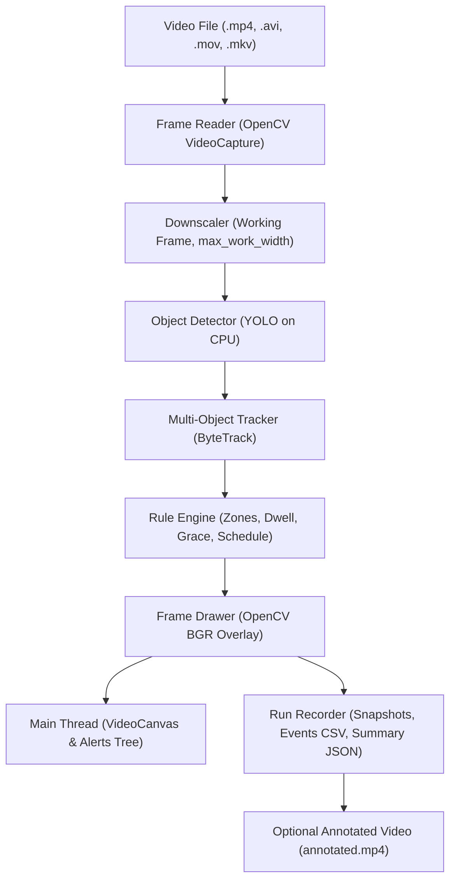
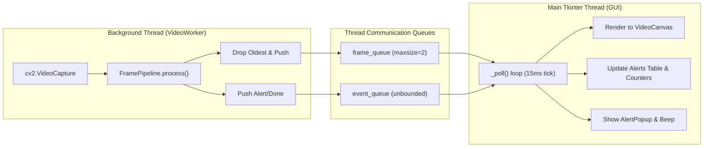

# Intrusion Guard Architecture

## 1. Overview and Data Flow Pipeline

The video processing pipeline operates sequentially on working frames downscaled to at most `max_work_width` (default 1280 px). All coordinate math, zone bounding, snapshots, and alerts operate in this working space.



---

## 2. Threading and Concurrency Model

To ensure the desktop interface remains completely responsive without freezing or stuttering during heavy deep-learning inference, all frame processing and tracking runs on a dedicated background worker thread (`VideoWorker`).



### Threading Guarantees
- **No Tkinter Calls from Worker:** The worker thread never touches or modifies any Tkinter widgets directly.
- **Backpressure and Pacing:** When real-time mode is enabled, the worker checks timing against `video_time_s`. If computer processing is slower than playback, frames are skipped cheaply via `cap.grab()` without decoding or running inference.
- **Bounded Frame Queue:** The `frame_queue` holds at most 2 frames. If full, the oldest unrendered frame is discarded so the GUI displays only the freshest frame.

---

## 3. Module Responsibilities

| Module | Responsibility | Primary Dependencies |
|---|---|---|
| `guard/schema.py` | Shared pure dataclasses (`Detection`, `Zone`, `TrackState`, `AlertEvent`, `SavedAlert`, `Settings`, message types). | None (Pure Python) |
| `guard/config.py` | Loads, saves, normalizes, and validates `config.yaml` atomically. Sanitizes zone geometry and numeric settings. | PyYAML |
| `guard/rules.py` | Geometric calculations (`point_in_polygon`), schedule checks (`is_zone_active`), dwell time tracking, and grace period logic. | None (Pure Python) |
| `guard/draw.py` | Visual rendering on BGR frames: semi-transparent zone polygons, color-coded tracking boxes, labels, and banner overlays. | OpenCV, NumPy |
| `guard/alerts.py` | Run artifact management: writes `events.csv`, encodes full annotated snapshots with alert headers, saves intruder crops, and generates `summary.json`. | OpenCV, NumPy |
| `guard/detector.py` | YOLO model initialization on CPU and ByteTrack tracker integration. Wraps Ultralytics. | Ultralytics, NumPy |
| `guard/pipeline.py` | `FramePipeline` (pure frame-in, result-out processing) and `VideoWorker` (background pacing and queue dispatch thread). | OpenCV, NumPy |
| `guard/gui/video_canvas.py` | Aspect-ratio preserving Tkinter canvas with letterboxing, coordinate transformation (`canvas_to_norm` / `norm_to_canvas`), and resize handling. | Tkinter, Pillow, OpenCV |
| `guard/gui/zone_dialog.py` | Modal dialog for naming zones, toggling allowed classes, and setting active hours. | Tkinter, ttk |
| `guard/gui/alert_popup.py` | Non-modal, non-blocking auto-dismissing toast pop-up window showing intrusion alerts and intruder thumbnails. | Tkinter, Pillow, OpenCV |
| `guard/gui/main_window.py` | Main desktop application window, state management, toolbar, alerts table, settings controls, and queue polling. | Tkinter, ttk |
| `headless.py` | CLI batch runner for automated headless evaluation across video files without launching a GUI. | OpenCV, PyYAML |
| `app.py` | GUI entry point. | Tkinter |

---

## 4. How to Extend

### Adding New Object Classes
1. Open `config.yaml`.
2. Under `classes`, add the COCO class ID and name (e.g., `1: bicycle`, `5: bus`, `7: truck`).
3. Reload or restart the application. The new class will automatically appear in zone configuration checkboxes and live tracking counters.

### Swapping the Detector
1. Implement the `DetectorProtocol` interface defined in `guard/detector.py`:
   ```python
   class CustomDetector:
       def detect(self, frame_bgr: np.ndarray) -> list[Detection]: ...
       def set_confidence(self, conf: float) -> None: ...
   ```
2. Pass the custom detector into `FramePipeline` or `VideoWorker`.

### Adding New Alert Notification Channels (e.g., Webhook / Telegram)
1. In `guard/alerts.py`, extend `RunRecorder.save_alert()`.
2. Trigger the desired network webhook, HTTP POST, or mobile notification alongside writing `events.csv`.

